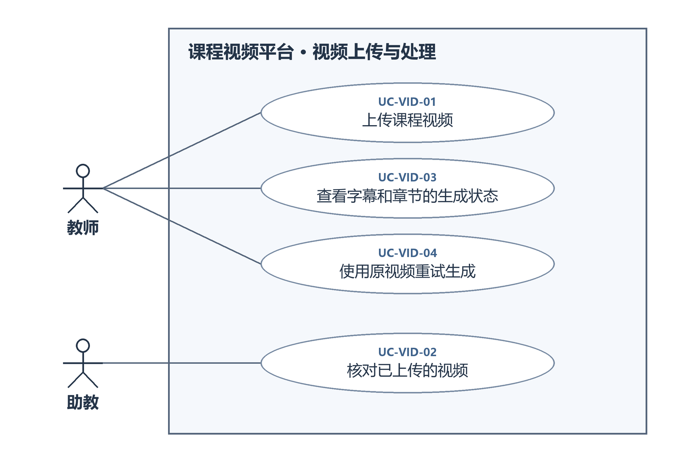

# AI 课程视频结构化管理与智能检索平台 · 软件需求规约（SRS）草稿

第三节课课前评审稿。**合稿负责人** B。各模块负责人补齐对应小节后，由 B 统一编号和术语并提交草稿 PR。

## 编号说明

**负责人** B 统一全组编号。

当前 C 模块使用「类型-模块-序号」的格式，便于在需求、用例和 GitHub Issue 之间查找对应关系。

| 部分 | 含义 |
|---|---|
| `FR` | Functional Requirement，功能需求 |
| `NFR` | Non-functional Requirement，非功能需求 |
| `UC` | Use Case，用例 |
| `VID` | Video，视频上传与处理模块 |
| `01` | 本模块同一类型下的第 1 条记录，后续依次递增 |

例如，`FR-VID-01` 是「上传课程视频」的功能需求，`UC-VID-01` 是对应的上传用例，GitHub Issue `#9` 用来跟踪该用户故事。`NFR-VID-01` 是本模块的第 1 条非功能需求。这些编号供草稿使用，合稿时按全组的编号规则统一。

## 1. 项目目标与范围

**负责人** A 确认项目目标和范围，B 整理入稿。

_待填写项目目标、本期范围和问卷依据。_

## 2. 用户角色与权限

**负责人** A 主笔，B、C、D 核对各自模块涉及的权限。

_待填写教师、助教、学生的权限及各角色可执行的操作。_

## 3. 用例图与典型场景

### 3.1 全组用例图

**负责人** C 汇总。A、B、D 提供各自模块的参与者和用例清单。

当前已纳入 C 模块图。全组总图待各模块清单齐全后由 C 汇总，并标明主要和次要参与者。

全组用例图的可编辑源文件将随用例图 PR 入库。

### 3.2 典型用例场景

#### 3.2.1 课程访问授权

**负责人** A。

_待填写。_

#### 3.2.2 课内检索与跳转观看

**负责人** B。

_待填写。_

#### 3.2.3 教师上传视频并生成待审核内容

**负责人** C。

**主要参与者**为课程教师。**次要参与者**为外部语音识别服务和章节生成服务。场景涉及 `UC-VID-01` 上传视频、`UC-VID-03` 查看生成状态和 `UC-VID-04` 重试处理。

**前置条件**为课程已创建，教师拥有上传权限，并已准备符合上传要求的视频文件。向外部服务发起处理前，教师须确认该视频的外部处理授权。

##### 主流程

1. 教师进入指定课程，选择并上传视频。系统保存原视频，并在该课程的视频列表中显示记录。
2. 教师确认外部处理授权后发起生成任务。任务开始运行后，处理详情显示「处理中」。
3. 系统根据视频生成带时间戳的字幕，再根据字幕生成章节草稿。
4. 生成成功后，系统将字幕和章节草稿关联到原视频，并将状态更新为「待审核」。后续由有审核权限的成员检查和确认。

##### 异常分支 · 生成失败后重试

1. 主流程第 3 步失败时，系统在原视频记录下显示「失败」并给出相应提示。
2. 原视频仍在且外部处理授权有效时，教师在该条记录的处理详情中选择「重试」。
3. 系统使用原视频重新发起生成，更新同一条视频记录的处理状态。成功后回到主流程第 4 步。再次失败时，显示本次失败状态和提示。

#### 3.2.4 内容审核与发布

**负责人** D。

**主要参与者**为助教和教师。**次要参与者**为学生和内容审核与发布服务。场景涉及 `UC-REV-01` 校对字幕文本、`UC-REV-02` 修正字幕时间戳、`UC-REV-03` 修订章节与摘要和 `UC-REV-04` 审核发布。

**前置条件**为视频已完成字幕与章节生成并处于「待审核」状态，助教拥有该课程的编辑权限，教师拥有该课程的发布权限。

##### 主流程

1. 助教打开待审核视频的审核页，系统显示字幕列表、章节草稿和当前审核状态。
2. 助教修正字幕片段的文本与时间范围，系统校验时间范围后保存，并记录修改人、修改时间和原值。
3. 助教修订章节标题与摘要，系统保存并记录修改。
4. 助教提交审核，系统把该视频标记为「待发布」。
5. 教师打开审核页，系统显示助教的修改记录和未确认项清单。
6. 教师确认全部内容后执行发布，系统把该视频状态更新为「已发布」。
7. 获授权的学生在检索结果中看到该视频的字幕片段，点击时间点跳转到对应讲解。

##### 异常分支 · 时间范围不合法

1. 助教保存的时间范围开始不早于结束，或结束超过视频时长时，系统拒绝保存，并在提示中给出视频实际时长。
2. 助教修正后重新保存，回到主流程第 2 步。

##### 异常分支 · 存在未确认内容

1. 教师执行发布时，该视频仍有章节处于待审核状态，系统拒绝发布，并在提示中给出未确认项数量。
2. 教师返回审核页处理未确认项后重新发布，回到主流程第 6 步。

## 4. 功能需求

各模块列出用例编号、需求描述、验收标准和关联 Issue。

### 4.1 课程与权限

**负责人** A。

_待填写。_

### 4.2 学生检索与观看

**负责人** B。

_待填写。_

### 4.3 视频上传与处理

**负责人** C。

#### FR-VID-01 · 上传课程视频

**用例 `UC-VID-01`**。系统应允许有课程上传权限的教师将视频上传到指定课程，并在课程视频列表中显示该视频的名称和当前处理状态。 [Issue #9](https://github.com/onnisama/Course-Video-Intelligence/issues/9)

- **Given** 课程已创建，教师具备上传权限，视频文件符合上传要求。
- **When** 教师在该课程中选择并提交视频文件。
- **Then** 该课程的视频列表出现上传的视频，显示视频名称和当前处理状态。

**异常场景 · 上传文件不符合要求**

- **Given** 教师拥有该课程的上传权限，待上传文件的格式不受支持，或文件大小超过项目规定的上限。
- **When** 教师尝试上传该文件。
- **Then** 系统拒绝上传，并提示具体原因。格式不受支持时提示允许的格式，文件过大时提示大小上限。课程视频列表和生成任务保持原状。

验收时分别测试「格式不支持、大小合规」和「格式受支持、大小超限」两种情况。

#### FR-VID-02 · 核对已上传的视频

**用例 `UC-VID-02`**。系统应允许有查看权限的助教查阅课程的已上传视频列表，并提供文件名和上传时间，供助教核对资料是否已入库。 [Issue #10](https://github.com/onnisama/Course-Video-Intelligence/issues/10)

- **Given** 助教有权查看该课程的视频，且课程已有一条视频上传记录。
- **When** 助教打开该课程的已上传视频列表。
- **Then** 列表显示该视频的文件名和上传时间。

#### FR-VID-03 · 查看字幕和章节的生成状态

**用例 `UC-VID-03`**。系统应向有权处理该视频的教师展示生成任务的当前状态。 [Issue #11](https://github.com/onnisama/Course-Video-Intelligence/issues/11)

- **Given** 教师有权处理该视频，已确认外部处理授权并发起生成任务。
- **When** 教师查看该视频的处理详情。
- **Then** 任务运行时显示「处理中」，生成成功、等待人工审核时显示「待审核」，任务失败时显示「失败」及相应提示。验收覆盖这三种状态。

#### FR-VID-04 · 使用原视频重试生成

**用例 `UC-VID-04`**。生成任务失败后，系统应允许有处理权限的教师使用原视频重新发起处理，并将重试进度关联到同一条视频记录。 [Issue #12](https://github.com/onnisama/Course-Video-Intelligence/issues/12)

- **Given** 教师有权处理该视频，原视频仍保存在课程中，外部处理授权有效，上一轮任务显示「失败」。
- **When** 教师在该视频的处理详情中选择「重试」。
- **Then** 系统使用原视频重新发起处理，教师可以在原视频记录下查看新的处理状态。重试成功后，新生成的字幕和章节进入「待审核」。

### 4.4 内容审核与发布

**负责人** D。

#### FR-REV-01 · 校对字幕文本

**用例 `UC-REV-01`**。系统应允许有课程编辑权限的教师或助教修改 AI 生成的字幕文本并保存，同时记录修改人、修改时间和原值。 [Issue #15](https://github.com/onnisama/Course-Video-Intelligence/issues/15)

- **Given** 助教对课程有编辑权限，字幕片段当前文本为「偏微分方程」。
- **When** 助教把文本改为「偏微分方程式」并保存。
- **Then** 保存成功，文本更新为新值，并记录修改人、修改时间和原值。

**补充验收**

- 文本为空或纯空格时，保存被拒绝，原文本不变。
- 调用者无该课程编辑权限时，请求被拒绝，原文本不变，并记录一次越权访问。
- 两名审核人同时修改同一片段时，后提交者收到冲突提示，先提交的内容保留。

#### FR-REV-02 · 修正字幕时间戳

**用例 `UC-REV-02`**。系统应允许有课程编辑权限的助教调整字幕片段的开始与结束时间，修正后学生的跳转定位随之改变。 [Issue #16](https://github.com/onnisama/Course-Video-Intelligence/issues/16)

- **Given** 助教对课程有编辑权限，视频时长 3600 秒，字幕片段当前为 118.0–120.0 秒。
- **When** 助教把该片段改为 118.0–120.5 秒并保存。
- **Then** 保存成功，时间范围更新，学生从播放器跳到 118.0 秒时该片段处于高亮显示状态。

**补充验收**

- 开始时间不早于结束时间时，保存被拒绝，原值不变。
- 结束时间超过视频时长时，保存被拒绝，提示中包含视频实际时长。
- 开始时间为负数时，保存被拒绝。
- 调用者无该课程编辑权限时，请求被拒绝，且响应不包含原时间数据。

#### FR-REV-03 · 修订章节与摘要

**用例 `UC-REV-03`**。系统应允许有审核权限的教师或助教修改 AI 生成的章节标题、时间范围与摘要。 [Issue #17](https://github.com/onnisama/Course-Video-Intelligence/issues/17)

- **Given** 视频已生成 3 个候选章节且均处于待审核状态，审核人对该课程有审核权限。
- **When** 审核人把第 2 个章节的标题改为「偏微分方程数值解」并保存。
- **Then** 保存成功，标题更新，并记录修改人、修改时间和原值。

**补充验收**

- 章节结束时间超过视频时长时，保存被拒绝，提示中包含视频实际时长。
- 标题为空时，保存被拒绝。
- 调用者无该课程审核权限时，请求被拒绝。

#### FR-REV-04 · 审核发布

**用例 `UC-REV-04`**。系统应允许有发布权限的教师在确认字幕、章节与摘要无误后发布，发布后内容对获授权的学生可见。 [Issue #18](https://github.com/onnisama/Course-Video-Intelligence/issues/18)

- **Given** 视频的字幕与章节均处于待审核状态，教师对该课程有发布权限。
- **When** 教师确认全部内容后执行发布。
- **Then** 发布成功，视频状态更新为「已发布」，获授权的学生能在检索结果中看到该视频的字幕片段并播放。

**补充验收**

- 调用者无该课程发布权限时，请求被拒绝，视频状态不变。
- 仍有未确认章节时，发布被拒绝，提示中包含未确认项数量。
- 已发布内容被修改后，视频状态回到待审核。

#### FR-REV-05 · 提交内容错误反馈

**用例 `UC-REV-05`**。系统应允许学生在已发布内容中识别自动生成的部分，并对具体字幕片段或章节提交错误反馈，教师与助教可查看反馈列表。 [Issue #19](https://github.com/onnisama/Course-Video-Intelligence/issues/19)

- **Given** 学生对课程有访问权限，视频的字幕由 AI 生成且尚未经人工确认。
- **When** 学生对该视频的字幕片段提交「术语识别错误」的反馈。
- **Then** 提交成功，反馈记录包含提交人、片段、内容和提交时间，该课程的教师与助教能在反馈列表中看到。

**补充验收**

- 未经人工确认的自动生成内容在播放页显示生成标识。
- 说明文字超过长度上限时，提交被拒绝。
- 反馈内容为空时，提交被拒绝。
- 调用者对课程无访问权限时，请求被拒绝。
- 同一学生对同一片段的未处理反馈达到上限后，继续提交被限流。

## 5. 非功能需求

**验收复核** D 检查各项非功能需求的验收条件是否可验证。

### 5.1 性能

**负责人** B。

_待填写检索性能需求及验收条件。_

### 5.2 安全

**负责人** A。

_待填写访问安全需求及验收条件。_

### 5.3 可用性

**负责人** C。

#### NFR-VID-01 · 生成服务故障时保持已发布视频可播放

字幕或章节生成服务发生故障期间，获授权的学生仍应能够播放已发布的视频。 [Issue #13](https://github.com/onnisama/Course-Video-Intelligence/issues/13)

- **Given** 测试课程中有一段已发布且可正常播放的视频，测试学生有权观看。测试环境模拟字幕或章节生成服务不可用。
- **When** 学生在故障持续期间从课程视频列表打开该视频并点击播放。
- **Then** 视频正常加载并开始播放，播放器的播放时间持续前进。

## 6. 约束条件

**负责人** A 和 D 提供规则，C 核对视频处理场景与规则的一致性，B 汇总。

### 6.1 外部处理授权

**负责人** A。

_待填写。_

### 6.2 人工审核与发布

**负责人** D。

1. 内容状态分为草稿、待审核、已发布三种。学生只能看到已发布的内容，草稿和待审核内容不得出现在学生的检索结果和播放页中。
2. 已发布内容被修改后，状态回到待审核，须重新确认才能再次发布。修改期间学生侧的可见行为待确认。
3. 审核与修改操作须留痕，至少包含操作人、操作时间、原值和修改后的值，可按内容追溯，也可按人追溯。
4. AI 生成内容与人工修订结果须可区分。对外展示未经人工确认的内容时，须标注其生成来源。
5. 审核类操作的权限由服务端校验，前端隐藏按钮不作为访问控制手段。
6. 字幕片段与章节的时间范围须满足：非负、开始时间早于结束时间、结束时间不超过视频时长。
7. 发布操作不依赖外部语音识别或章节生成服务的可用性，服务故障期间已发布内容仍可播放。
8. 同一内容被并发修改时，须以冲突提示阻止静默覆盖，后提交者的修改不得覆盖先提交者的结果。
9. 学生的错误反馈须关联到具体内容片段，并可按课程汇总供教师与助教查看。
