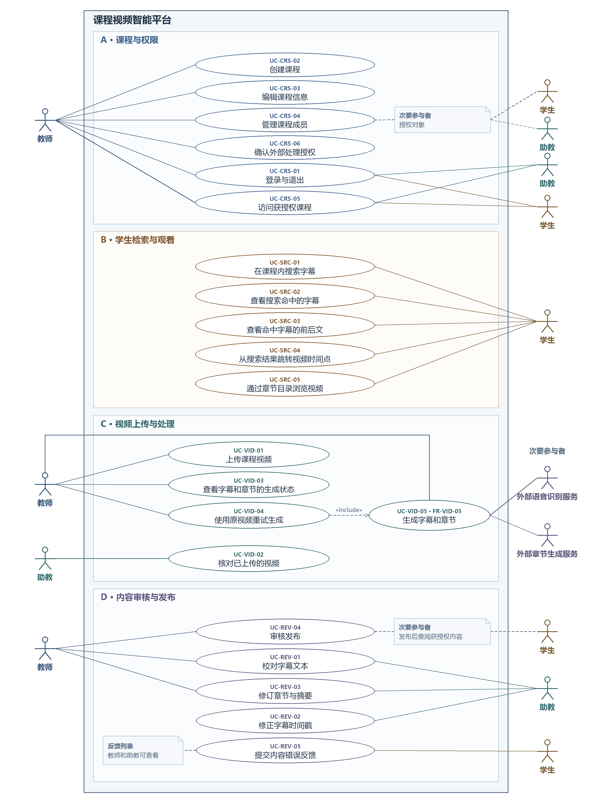

# AI 课程视频结构化管理与智能检索平台 · 软件需求规约（SRS）草稿

第三节课课前评审稿。**合稿负责人** B。各模块负责人补齐对应小节后，由 B 统一编号和术语并提交草稿 PR。

## 编号说明

**负责人** B 统一全组编号。

全组草稿统一使用「类型-模块-序号」的格式，便于在需求、用例和 GitHub Issue 之间查找对应关系。

| 部分 | 含义 |
|---|---|
| `FR` | Functional Requirement，功能需求 |
| `NFR` | Non-functional Requirement，非功能需求 |
| `UC` | Use Case，用例 |
| `VID` | Video，视频上传与处理模块 |
| `CRS` | Course，课程与权限模块 |
| `SRC` | Search，学生检索与观看模块 |
| `REV` | Review，内容审核与发布模块 |
| `01` | 本模块同一类型下的第 1 条记录，后续依次递增 |

例如，`FR-VID-01` 是「上传课程视频」的功能需求，`UC-VID-01` 是对应的上传用例，GitHub Issue `#9` 用来跟踪该用户故事。`NFR-VID-01` 是本模块的第 1 条非功能需求。这些编号供草稿使用，合稿时按全组的编号规则统一。

## 1. 项目目标与范围

**负责人** A 确认项目目标和范围，B 整理入稿。

本项目面向高校课程录播，帮助教师和助教整理教学视频及其字幕、章节和摘要，并帮助学生找到课程视频中的知识点、跳到对应时间观看。

课程设计按三个可交付增量组织。

1. **v0.1 基础平台**。登录、角色与课程成员管理、课程视频上传与播放。
2. **v0.2 内容结构化**。经授权后生成带时间戳的字幕、章节和摘要，提供处理状态、失败重试以及人工校对、审核和发布。
3. **v0.3 课内检索**。学生在一门已获授权的课程内检索已发布的字幕，查看匹配片段并跳到对应时间点。

跨课程检索、时间点笔记、收藏和观看进度属于候选功能，在线直播、原生移动端、复杂教务和自研模型均列在范围外。第三方 ASR 和 LLM 用于内容结构化。外部集成部分的具体方式后续考虑。

## 2. 用户角色与权限

**负责人** A 主笔，B、C、D 核对各自模块涉及的权限。

权限按**目标课程和所请求的操作**检查。同一账号在不同课程中的权限分别判定，服务端在读取或修改课程资源前校验。

| 角色 | 课程内可执行的操作 |
|---|---|
| 教师 | 具备创建权限时可创建课程。具备目标课程的相应权限时，可编辑课程信息、管理成员、上传视频、确认外部处理授权、发起或重试生成任务、修订和审核内容。发布须具备该课程的发布权限。 |
| 助教 | 在获授权的课程核对已上传视频的文件名和上传时间；具备相应编辑权限时，可校对字幕、修正时间戳、修订章节和摘要，并提交教师审核。 |
| 学生 | 进入获授权的课程，播放已发布视频，检索已发布字幕并跳转到对应时间点，对已发布内容中的自动生成部分提交错误反馈。内容可见性按 §6.2 核对。 |

## 3. 用例图与典型场景

### 3.1 全组用例图

**负责人** C 汇总。A、B、D 提供各自模块的参与者和用例清单。

下图汇总四个模块的 20 个编号用例及其参与者，供团队评审核对。

*课程视频智能平台用例图*

[C 模块用例图](./视频上传与处理-用例图.png)可用于对照视频上传与处理用例。

全组用例图的可编辑源文件按仓库约定单独提交评审。

A 模块的用例名称、临时编号和参与者见 [§4.1 课程与权限](#41-课程与权限)。

### 3.2 典型用例场景

#### 3.2.1 课程访问授权

**负责人** A。

**主要参与者**为有该课程成员管理权限的教师。**次要参与者**为被授权的学生。场景涉及 `UC-CRS-04` 管理课程成员和 `UC-CRS-05` 访问获授权课程。

**前置条件**为教师已登录，课程已创建，目标学生已有可用账号，当前无该课程的访问权限。

##### 主流程

1. 教师打开指定课程的成员管理页面，选择目标学生并提交授权。
2. 系统校验教师对该课程的成员管理权限及目标账号，保存学生的课程成员关系，并在课程成员列表显示授权结果。
3. 学生登录后，在课程列表看到该课程并进入。课程内有可访问的已发布视频时，学生可以观看；课内检索按 §4.2 执行。

##### 备选与异常分支

- 教师撤销该学生的课程访问权限后，该课程从学生的课程列表移除，学生再次打开课程或请求其中的视频时被拒绝。
- 调用者无该课程成员管理权限，或目标账号不可用时，授权请求被拒绝，课程成员关系不变。
- 学生在获得授权前打开课程链接，服务端拒绝请求，响应不返回课程或视频资料。

#### 3.2.2 课内检索与跳转观看

**负责人** B。

**主要参与者**为有课程访问权限的学生。本场景涉及 `UC-SRC-01` 至 `UC-SRC-04`；`UC-SRC-05` 是通过当前视频章节目录浏览的备选入口。

**前置条件**为学生已登录并获准访问课程，课程内存在已发布的视频及字幕。章节入口要求当前视频具有已确认且已发布的章节。

##### 主流程

1. 学生进入有权访问的课程，输入非空关键词并搜索。
2. 系统校验课程访问权限，仅检索本课程已发布视频的字幕，不返回受限内容及其命中数量。
3. 系统展示命中字幕、所属视频名称及可点击的字幕起始时间。每条结果中的视频、字幕和时间点正确关联，多视频命中及翻页后仍保持一致。
4. 学生展开结果，系统按时间顺序显示命中字幕及紧邻的前 1 条、后 1 条字幕；命中字幕使用高亮背景并显示“命中字幕”文字。首尾片段只显示实际存在的相邻内容，不跨视频取字幕。
5. 学生点击结果中的时间点，系统再次校验目标视频的访问权限与发布状态，打开对应视频并定位到字幕起点。跳转完成后，播放器时间与目标时间的绝对差不超过 1.0 秒。

##### 备选与异常分支

- 学生可打开当前视频的章节目录，选择已确认且已发布的章节，跳转到该章节起点，定位误差同为 ≤ 1.0 秒；当前视频的章节目录与课程下的视频列表分别处理。
- 空查询提示输入关键词；无可见命中显示无结果状态；当前视频没有可见章节时显示空目录。
- 无课程或视频访问权限、权限被撤销，或目标视频处于草稿、待审核、已撤回发布等不可见状态时，后续检索、上下文读取、章节读取及播放均由服务端校验，不通过旧结果或片段 ID 返回受限内容。
- 时间戳缺失、为负数或超出视频时长时，提示无效并停止跳转；视频不可用时提示并停止播放操作。
- 定位验收使用暂停状态的播放器，在 `seeked` 事件后立即读取 `currentTime`；具体标准见 §4.2。

**评审口径**：默认上下文前后各 1 条、定位误差 ≤ 1.0 秒，与本轮修订的 Issue #30、#31、#32 对齐，作为本地待审稿；后续变更须同步故事与 SRS。

**故事追溯**：[#28](https://github.com/onnisama/Course-Video-Intelligence/issues/28)、[#29](https://github.com/onnisama/Course-Video-Intelligence/issues/29)、[#30](https://github.com/onnisama/Course-Video-Intelligence/issues/30)、[#31](https://github.com/onnisama/Course-Video-Intelligence/issues/31)、[#32](https://github.com/onnisama/Course-Video-Intelligence/issues/32)。

#### 3.2.3 教师上传视频并生成待审核内容

**负责人** C。

**主要参与者**为课程教师。**次要参与者**为外部语音识别服务和章节生成服务。场景涉及 `UC-VID-01` 上传视频、`UC-VID-03` 查看生成状态和 `UC-VID-04` 重试处理。

**前置条件**为课程已创建，教师拥有上传权限，并已准备符合上传要求的视频文件。向外部服务发起处理前，教师须确认该视频的外部处理授权。

##### 主流程

1. 教师进入指定课程，选择并上传视频。系统保存原视频，并在该课程的视频列表中显示状态为「草稿」的视频记录。
2. 教师确认外部处理授权后发起生成任务。任务开始运行后，处理详情的生成进度显示「处理中」。
3. 系统根据视频生成带起止时间的字幕片段，再根据字幕生成章节。每个章节包含标题、起止时间和摘要。
4. 完整结果生成后，处理详情的生成进度显示「成功」。系统将字幕片段、章节及章节摘要作为同一批待审核结果关联到原视频，并将视频状态更新为「待审核」。每条字幕片段和每个章节初始为「待确认」，由有审核权限的教师或助教按第 3.2.4 节处理。

##### 异常分支 · 生成失败后重试

1. 主流程第 3 步失败时，同一条视频记录的生成进度显示「失败」及相应提示，视频仍为「草稿」。
2. 只有当前生成进度为「失败」、原视频仍在且外部处理授权有效时，有处理权限的教师才可在该视频的处理详情中选择「重试」。
3. 系统使用原视频重新发起生成，在同一条视频记录下将生成进度更新为「处理中」。
4. 重试成功时，本次完整的生成结果仅替换失败任务的临时产物，其余交接步骤与主流程第 4 步相同。已有人工审核中的稿件和已发布内容保持原样。再次失败时，生成进度显示「失败」及本次失败提示，视频仍为「草稿」。

#### 3.2.4 内容审核与发布

**负责人** D。

**主要参与者**为助教和教师。**次要参与者**为学生（发布后受益）。场景涉及 `UC-REV-01` 校对字幕文本、`UC-REV-02` 修正字幕时间戳、`UC-REV-03` 修订章节与摘要和 `UC-REV-04` 审核发布。

**前置条件**为视频已完成字幕与章节生成并处于「待审核」状态，助教拥有该课程的编辑权限，教师拥有该课程的发布权限。

##### 主流程

1. 助教打开待审核视频的审核页，系统显示字幕列表、章节草稿，以及字幕片段和章节各自的未确认数量。
2. 助教修正字幕片段的文本与时间范围，系统校验时间范围后保存，并记录修改人、修改时间和原值。
3. 助教修订章节标题与摘要，系统保存并记录修改。
4. 助教确认已校对的内容，系统把对应内容项的标记置为「已确认」；批量确认 N 条时，该类未确认数量减少 N。
5. 助教提交审核，系统记录一条已提交给教师的审核记录，视频状态保持「待审核」。
6. 教师打开审核页，系统显示助教的修改记录和两类未确认数量。
7. 教师确认剩余内容后执行发布，系统校验两类未确认数量均为 0，把该视频状态更新为「已发布」。
8. 获授权的学生在检索结果中看到该视频的字幕片段，点击时间点跳转到对应讲解。

##### 异常分支 · 时间范围不合法

1. 助教保存的时间范围开始不早于结束，或结束超过视频时长时，系统拒绝保存，并在提示中给出视频实际时长。
2. 助教修正后重新保存，回到主流程第 2 步。

##### 异常分支 · 存在未确认内容

1. 教师执行发布时，该视频仍有未确认的字幕片段或章节，系统拒绝发布，并在提示中分别给出两类未确认数量。
2. 教师返回审核页确认剩余内容后重新发布，回到主流程第 7 步。

## 4. 功能需求

各模块列出用例编号、需求描述、验收标准和关联 Issue。

### 4.1 课程与权限

**负责人** A。以下编号供草稿及用例图使用，合稿时由 B 统一。[Task #14](https://github.com/onnisama/Course-Video-Intelligence/issues/14)

#### FR-CRS-01 · 登录与退出

**用例 `UC-CRS-01`**。主要参与者为教师、助教和学生。系统应允许持有有效账号的用户登录、识别后续课程请求的身份，并提供退出操作。 [Task #14](https://github.com/onnisama/Course-Video-Intelligence/issues/14)

- **Given** 测试用户持有一个有效账号。
- **When** 用户完成正确的身份验证。
- **Then** 用户登录成功，进入课程页面，仅看到有权访问的课程。
- **补充验收**。退出后，用户在当前会话中再次打开受保护的课程时须重新登录。身份验证失败时，系统提示登录失败，用户无法访问受保护的课程资源。

#### FR-CRS-02 · 创建课程

**用例 `UC-CRS-02`**。主要参与者为教师。系统应允许有创建权限的教师创建课程。 [Task #14](https://github.com/onnisama/Course-Video-Intelligence/issues/14) · [Issue #9 上传视频的课程前置条件](https://github.com/onnisama/Course-Video-Intelligence/issues/9)

- **Given** 教师已登录并拥有创建课程的权限。
- **When** 教师填写有效的课程名称及必填信息并提交。
- **Then** 系统创建课程，该教师可以从其课程列表打开并管理这门课程。
- **异常验收**。课程名称为空或账号无创建权限时，请求被拒绝，课程列表无新增记录。

#### FR-CRS-03 · 编辑课程信息

**用例 `UC-CRS-03`**。主要参与者为教师。系统应允许有该课程管理权限的教师修改课程基本信息。 [Task #14](https://github.com/onnisama/Course-Video-Intelligence/issues/14)

- **Given** 教师对课程 A 有管理权限，课程已有名称。
- **When** 教师填写新的有效课程名称并保存。
- **Then** 重新打开课程 A 后显示新名称，课程成员和已上传视频仍关联课程 A。
- **异常验收**。教师尝试修改其无权管理的课程 B 时，请求被拒绝，课程 B 的信息不变。

#### FR-CRS-04 · 管理课程成员

**用例 `UC-CRS-04`**。主要参与者为有该课程成员管理权限的教师，次要参与者为涉及授权的学生或助教。系统应允许该教师为指定账号授予或撤销本课程的学生或助教权限。 [Issue #24](https://github.com/onnisama/Course-Video-Intelligence/issues/24) · [Task #14](https://github.com/onnisama/Course-Video-Intelligence/issues/14) · [Issue #10 助教查看权限](https://github.com/onnisama/Course-Video-Intelligence/issues/10)

- **Given** 教师对课程 A 有成员管理权限，测试账号有效且还不是课程 A 的成员。
- **When** 教师为该账号授予课程 A 的学生或助教权限。
- **Then** 课程 A 的成员列表显示该账号及其课程角色。该账号随后可执行相应角色获准的操作。验收分别覆盖学生和助教。
- **补充验收**。撤销后，该账号再次请求课程 A 的受保护资源时被拒绝，对其他课程的权限保持原样。无课程 A 成员管理权限的调用者尝试授予或撤销权限时，请求被拒绝，成员列表不变。

#### FR-CRS-05 · 访问获授权课程

**用例 `UC-CRS-05`**。主要参与者为教师、助教和学生。系统应允许用户进入其有权访问的课程，并按课程权限提供对应资源和操作。 [Issue #25](https://github.com/onnisama/Course-Video-Intelligence/issues/25) · [Task #14](https://github.com/onnisama/Course-Video-Intelligence/issues/14) · [Issue #18 发布后学生可见](https://github.com/onnisama/Course-Video-Intelligence/issues/18)

- **Given** 测试学生只获授权访问课程 A，课程 A 有已发布视频，课程 B 也有已发布视频。
- **When** 学生打开课程列表，进入课程 A，并尝试直接打开课程 B 的链接。
- **Then** 列表只显示课程 A，学生能打开课程 A 的已发布视频。访问课程 B 被拒绝，响应不含课程 B 的资料。

#### FR-CRS-06 · 确认外部处理授权

**用例 `UC-CRS-06`**。主要参与者为有该视频处理权限的教师。发起生成前，系统应让教师对照 §6.1 确认该视频及其派生数据的外发授权范围，并关联到原视频，供生成和重试时校验。 [Issue #26](https://github.com/onnisama/Course-Video-Intelligence/issues/26) · [Task #14](https://github.com/onnisama/Course-Video-Intelligence/issues/14) · [Issue #11 查看生成状态](https://github.com/onnisama/Course-Video-Intelligence/issues/11) · [Issue #12 重试生成](https://github.com/onnisama/Course-Video-Intelligence/issues/12)

- **Given** 课程视频已上传，教师有该视频的处理权限，并已核对来源、授权及外发范围。
- **When** 教师针对该视频提交确认。
- **Then** 系统保存该视频的授权确认结果，发起生成时可据此校验本次外发是否获准。
- **异常验收**。没有该视频处理权限的调用者提交确认时，请求被拒绝，原授权状态不变。未确认或授权未覆盖本次处理时，按 §6.1 拒绝相关外发。

### 4.2 学生检索与观看

**负责人** B。以下验收条件与本轮修订的 Issue #28–#32 对齐，编号沿用全组现有规则。

#### FR-SRC-01 · 学生在课程内搜索字幕

**用例 `UC-SRC-01`**。主要参与者为学生。系统应允许学生在有访问权限的课程内按关键词搜索已发布视频的字幕。 [Issue #28](https://github.com/onnisama/Course-Video-Intelligence/issues/28)

- **Given** 学生有课程 A 的访问权限。A 的已发布视频、A 的待审核内容以及课程 B 的内容中都包含同一关键词。
- **When** 学生在课程 A 中输入该关键词搜索。
- **Then** 结果包含 A 的已发布匹配片段，不包含课程 B 或 A 的待审核内容，也不包含这些受限内容的命中数量。

**补充验收条件**

- 搜索词为空或仅为空格时，不发起检索，并提示输入关键词。
- 课程内没有匹配字幕时，显示无结果状态。
- 学生无权访问课程 B 时，直接请求搜索 B 会被服务端拒绝，且不返回 B 的字幕和命中数量。权限控制参见 [Issue #27](https://github.com/onnisama/Course-Video-Intelligence/issues/27)。

**问卷依据与来源**

316 名学生中，175 名（55.4%）希望在一门课程的全部视频中搜索。

[课内搜索统计](https://github.com/onnisama/Course-Video-Intelligence/blob/1b30fca11c946ee251f86751eee785b119068464/docs/research/%E8%AF%BE%E7%A8%8B%E8%A7%86%E9%A2%91%E5%B9%B3%E5%8F%B0%E9%9C%80%E6%B1%82%E8%B0%83%E7%A0%94%E4%B8%8E%E7%AB%9E%E5%93%81%E5%88%86%E6%9E%90%E6%8A%A5%E5%91%8A.md#L196)

#### FR-SRC-02 · 学生查看搜索命中的字幕

**用例 `UC-SRC-02`**。主要参与者为学生。系统应在搜索结果中展示视频名称、匹配字幕和可点击时间点，保持三者属于同一片段。 [Issue #29](https://github.com/onnisama/Course-Video-Intelligence/issues/29)

- **Given** 学生有课程 A 的访问权限，A 中两段已发布视频均有命中字幕，每条字幕均关联所属视频和起始时间。
- **When** 学生查看搜索结果。
- **Then** 每条结果显示正确的视频名称、匹配字幕及可点击时间点；视频、字幕和时间点属于同一片段，点击后打开该视频并按 [Issue #31](https://github.com/onnisama/Course-Video-Intelligence/issues/31) 定位。

**补充验收条件**

- 多视频命中时，每条结果均保持正确关联，不把一段视频的字幕或时间点绑定到另一段视频。若列表采用分页，翻页后仍满足该要求；若不分页，则完整展示返回的结果并核对关联。
- 学生无权访问某课程或视频时，即使直接请求接口，也不得返回受限视频的名称、字幕、时间点或命中数量；参见 [Issue #27](https://github.com/onnisama/Course-Video-Intelligence/issues/27)。
- 草稿、待审核和其他未发布视频不得出现在学生结果中；搜索后视频被撤回发布或权限被撤销时，后续读取和跳转请求须再次校验并拒绝受限内容。
- 没有可见匹配结果时显示无结果状态，不用受限视频的信息补齐列表。

**问卷依据与来源**

316 名学生中，236 名（74.7%）希望结果显示“匹配字幕”。视频名称的展示是结合报告 §4.2 拟定的交互设计，非问卷单独统计项。

[匹配字幕统计](https://github.com/onnisama/Course-Video-Intelligence/blob/1b30fca11c946ee251f86751eee785b119068464/docs/research/%E8%AF%BE%E7%A8%8B%E8%A7%86%E9%A2%91%E5%B9%B3%E5%8F%B0%E9%9C%80%E6%B1%82%E8%B0%83%E7%A0%94%E4%B8%8E%E7%AB%9E%E5%93%81%E5%88%86%E6%9E%90%E6%8A%A5%E5%91%8A.md#L198)

#### FR-SRC-03 · 学生查看命中字幕的前后文

**用例 `UC-SRC-03`**。主要参与者为学生。系统应允许学生展开命中字幕，默认显示紧邻的前 1 条和后 1 条字幕，按时间顺序排列并区分命中片段。 [Issue #30](https://github.com/onnisama/Course-Video-Intelligence/issues/30)

- **Given** 学生有课程访问权限，命中字幕属于已发布视频，按时间排序后前后均存在至少两条字幕。
- **When** 学生展开该搜索结果。
- **Then** 默认仅显示命中字幕、紧邻的前 1 条和后 1 条字幕，共 3 条，按时间升序排列；命中片段使用高亮背景并显示“命中字幕”文字，明确区别于上下文。

**补充验收条件**

- 默认上下文固定为前后各 1 条，不使用“至少 1 条”作为验收口径；字幕按所属视频内的时间顺序取相邻片段，不跨视频取内容。
- 命中片段是首条时，只显示命中片段及后 1 条；是末条时，只显示前 1 条及命中片段；视频仅有一条字幕时只显示命中片段。片段不重复、不越界、不补造内容。
- 对无权访问的课程或视频，直接调用上下文接口也须被服务端拒绝，不返回字幕及相邻内容；参见 [Issue #27](https://github.com/onnisama/Course-Video-Intelligence/issues/27)。
- 对草稿、待审核或已撤回发布的视频，不允许通过已知片段 ID 或旧搜索结果拉取上下文；参见 [Issue #18](https://github.com/onnisama/Course-Video-Intelligence/issues/18)。

**问卷依据与来源**

316 名学生中，133 名（42.1%）难以判断命中内容是否相关，197 名（62.3%）希望看到“命中前后字幕”。前后各 1 条是本次按评审意见明确的默认验收口径，非问卷给出的条数。

[相关性困难统计](https://github.com/onnisama/Course-Video-Intelligence/blob/1b30fca11c946ee251f86751eee785b119068464/docs/research/%E8%AF%BE%E7%A8%8B%E8%A7%86%E9%A2%91%E5%B9%B3%E5%8F%B0%E9%9C%80%E6%B1%82%E8%B0%83%E7%A0%94%E4%B8%8E%E7%AB%9E%E5%93%81%E5%88%86%E6%9E%90%E6%8A%A5%E5%91%8A.md#L194) · [前后字幕统计](https://github.com/onnisama/Course-Video-Intelligence/blob/1b30fca11c946ee251f86751eee785b119068464/docs/research/%E8%AF%BE%E7%A8%8B%E8%A7%86%E9%A2%91%E5%B9%B3%E5%8F%B0%E9%9C%80%E6%B1%82%E8%B0%83%E7%A0%94%E4%B8%8E%E7%AB%9E%E5%93%81%E5%88%86%E6%9E%90%E6%8A%A5%E5%91%8A.md#L200)

#### FR-SRC-04 · 学生从搜索结果跳转视频时间点

**用例 `UC-SRC-04`**。主要参与者为学生。系统应允许学生从搜索结果时间点跳转到对应视频的字幕起点，定位误差不超过 1.0 秒。 [Issue #31](https://github.com/onnisama/Course-Video-Intelligence/issues/31)

- **Given** 学生有权访问一段已发布视频，搜索结果所关联字幕的起始时间为 118 秒。
- **When** 学生点击该时间点。
- **Then** 系统打开对应视频并执行跳转；跳转完成后，播放器 currentTime 与目标起始时间的绝对差不超过 1.0 秒，即 |currentTime − 118| ≤ 1.0 秒。

**补充验收条件**

- 测量使用暂停状态的播放器，在 seeked 事件后立即读取 currentTime，避免正常播放造成的时间增长影响误差；多个测试时间点逐个满足 ≤ 1.0 秒。
- 搜索结果的视频 ID 和字幕起始时间必须属于同一片段，不得跳到其他视频或误用字幕结束时间；字幕时间戳修正后按最新可见数据定位，参见 [Issue #16](https://github.com/onnisama/Course-Video-Intelligence/issues/16)。
- 时间点缺失、为负数或超过视频时长时，系统提示时间点无效，不执行错误跳转。
- 学生无权访问目标视频，或目标视频未发布、已撤回发布时，服务端拒绝读取和播放，不返回视频内容；参见 [Issue #27](https://github.com/onnisama/Course-Video-Intelligence/issues/27)、[Issue #18](https://github.com/onnisama/Course-Video-Intelligence/issues/18)。
- 1.0 秒为本次按评审意见写入的草稿验收阈值，后续如需变更应由团队评审并同步 SRS。

**问卷依据与来源**

316 名学生中，217 名（68.7%）希望结果显示“可点击时间点”。定位误差阈值属于工程验收口径，非问卷结论。

[可点击时间点统计](https://github.com/onnisama/Course-Video-Intelligence/blob/1b30fca11c946ee251f86751eee785b119068464/docs/research/%E8%AF%BE%E7%A8%8B%E8%A7%86%E9%A2%91%E5%B9%B3%E5%8F%B0%E9%9C%80%E6%B1%82%E8%B0%83%E7%A0%94%E4%B8%8E%E7%AB%9E%E5%93%81%E5%88%86%E6%9E%90%E6%8A%A5%E5%91%8A.md#L199)

#### FR-SRC-05 · 学生通过章节目录浏览视频

**用例 `UC-SRC-05`**。主要参与者为学生。系统应允许学生从当前视频的已确认且已发布章节目录跳转到章节起点，定位误差不超过 1.0 秒。 [Issue #32](https://github.com/onnisama/Course-Video-Intelligence/issues/32)

- **Given** 学生有课程及当前视频的访问权限，该视频已发布，目录中存在已确认章节，其起始时间为 300 秒。
- **When** 学生选择该章节。
- **Then** 播放器保持或打开该章节所属的视频并定位至章节起点；跳转完成后 |currentTime − 300| ≤ 1.0 秒。

**补充验收条件**

- 本故事的目录指当前视频的章节目录；课程下的视频列表属于另一层级，不混用两者的空状态。
- 当前视频没有已确认且已发布的章节时，章节目录显示空状态；不展示未确认章节，也不展示草稿、待审核或其他未发布视频的章节。
- 在暂停状态下，于 seeked 事件后立即读取 currentTime，逐个核对章节起点，定位误差统一为 ≤ 1.0 秒，与 [Issue #31](https://github.com/onnisama/Course-Video-Intelligence/issues/31) 使用相同口径。
- 章节时间点缺失、为负数或超出视频时长时，提示无效并停止跳转，不定位到错误小节。
- 学生无权访问课程或视频，或视频被撤回发布时，直接请求章节接口和播放链接均被服务端拒绝，不返回受限章节及视频内容；参见 [Issue #27](https://github.com/onnisama/Course-Video-Intelligence/issues/27)。
- 1.0 秒为本次按评审意见写入的草稿验收阈值，后续变更须同步 [Issue #31](https://github.com/onnisama/Course-Video-Intelligence/issues/31) 与 SRS；内容发布规则参见 [Issue #18](https://github.com/onnisama/Course-Video-Intelligence/issues/18)。

**问卷依据与来源**

316 名学生中，122 名（38.6%）认为“章节缺失或不够细”。章节导航是据此拟定的功能；定位误差为工程验收口径。

[章节缺失统计](https://github.com/onnisama/Course-Video-Intelligence/blob/1b30fca11c946ee251f86751eee785b119068464/docs/research/%E8%AF%BE%E7%A8%8B%E8%A7%86%E9%A2%91%E5%B9%B3%E5%8F%B0%E9%9C%80%E6%B1%82%E8%B0%83%E7%A0%94%E4%B8%8E%E7%AB%9E%E5%93%81%E5%88%86%E6%9E%90%E6%8A%A5%E5%91%8A.md#L195)

### 4.3 视频上传与处理

**负责人** C。

#### FR-VID-01 · 上传课程视频

**用例 `UC-VID-01`**。系统应允许有课程上传权限的教师将视频上传到指定课程，并在课程视频列表中显示该视频的名称和当前处理状态。 [Issue #9](https://github.com/onnisama/Course-Video-Intelligence/issues/9)

- **Given** 课程已创建，教师具备上传权限，视频文件符合上传要求。
- **When** 教师在该课程中选择并提交视频文件。
- **Then** 该课程的视频列表出现上传的视频，显示视频名称和当前处理状态。

**异常场景 · 上传文件不符合要求**

- **Given** 教师拥有该课程的上传权限，待上传文件的格式不受支持，或文件大小超过项目规定的上限。
- **When** 教师尝试上传该文件。
- **Then** 系统拒绝上传，并提示具体原因。格式不受支持时提示允许的格式，文件过大时提示大小上限。课程视频列表和生成任务保持原状。

验收时分别测试「格式不支持、大小合规」和「格式受支持、大小超限」两种情况。

#### FR-VID-02 · 核对已上传的视频

**用例 `UC-VID-02`**。系统应允许有查看权限的助教查阅课程的已上传视频列表，并提供文件名和上传时间，供助教核对资料是否已入库。 [Issue #10](https://github.com/onnisama/Course-Video-Intelligence/issues/10)

- **Given** 助教有权查看该课程的视频，且课程已有一条视频上传记录。
- **When** 助教打开该课程的已上传视频列表。
- **Then** 列表显示该视频的文件名和上传时间。

#### FR-VID-03 · 查看字幕和章节的生成状态

**用例 `UC-VID-03`**。系统应向有权处理该视频的教师分别展示生成进度和视频状态。 [Issue #11](https://github.com/onnisama/Course-Video-Intelligence/issues/11)

- **Given** 教师有权处理该视频，已确认外部处理授权并发起生成任务。
- **When** 教师打开该视频的处理详情。
- **Then** 处理详情按以下情况展示生成进度和视频状态。
  - 生成任务正在运行时，进度显示「处理中」。
  - 生成成功并交付审核时，进度显示「成功」，视频状态显示「待审核」。
  - 生成失败时，进度显示「失败」及相应提示，视频仍为「草稿」。

#### FR-VID-04 · 使用原视频重试生成

**用例 `UC-VID-04`**。仅在当前生成进度为「失败」时，系统才允许有处理权限的教师使用原视频重新发起生成，并在同一条视频记录下显示重试进度。 [Issue #12](https://github.com/onnisama/Course-Video-Intelligence/issues/12)

**当前生成失败**

- **Given** 教师有权处理该视频，原视频仍保存在课程中，外部处理授权有效，当前生成进度为「失败」。
- **When** 教师在该视频的处理详情中选择「重试」。
- **Then** 系统使用原视频重新发起生成，并在同一条视频记录下将生成进度更新为「处理中」。
  - 重试成功时，生成进度更新为「成功」。本次生成的完整字幕片段、章节和章节摘要作为同一批待审核结果关联到原视频，仅替换失败任务的临时产物。视频进入「待审核」，本次生成的每条字幕片段和每个章节初始化为「待确认」。已有人工审核中的稿件和已发布内容保持原样。
  - 再次失败时，生成进度显示「失败」及本次失败提示，视频仍为「草稿」。

**当前生成未失败**

- **Given** 教师有权处理该视频，当前生成进度为「处理中」或「成功」，或该视频尚未发起过生成。
- **When** 教师打开该视频的处理详情或尝试对该视频发起重试。
- **Then** 重试不可用。系统拒绝重试请求，保留已有审核稿和已发布内容。

### 4.4 内容审核与发布

**负责人** D。

#### FR-REV-01 · 校对字幕文本

**用例 `UC-REV-01`**。系统应允许有课程编辑权限的教师或助教修改 AI 生成的字幕文本并保存，同时记录修改人、修改时间和原值。 [Issue #15](https://github.com/onnisama/Course-Video-Intelligence/issues/15)

- **Given** 助教对课程有编辑权限，字幕片段当前文本为「偏微分方程」。
- **When** 助教把文本改为「偏微分方程式」并保存。
- **Then** 保存成功，文本更新为新值，并记录修改人、修改时间和原值。

**补充验收**

- 文本为空或纯空格时，保存被拒绝，原文本不变。
- 调用者无该课程编辑权限时，请求被拒绝，原文本不变，并记录一次越权访问。
- 两名审核人同时修改同一片段时，后提交者收到冲突提示，先提交的内容保留。

#### FR-REV-02 · 修正字幕时间戳

**用例 `UC-REV-02`**。系统应允许有课程编辑权限的助教调整字幕片段的开始与结束时间，修正后学生的跳转定位随之改变。 [Issue #16](https://github.com/onnisama/Course-Video-Intelligence/issues/16)

- **Given** 助教对课程有编辑权限，视频时长 3600 秒，字幕片段当前为 118.0–120.0 秒。
- **When** 助教把该片段改为 118.0–120.5 秒并保存。
- **Then** 保存成功，时间范围更新，学生从播放器跳到 118.0 秒时该片段处于高亮显示状态。

**补充验收**

- 开始时间不早于结束时间时，保存被拒绝，原值不变。
- 结束时间超过视频时长时，保存被拒绝，提示中包含视频实际时长。
- 开始时间为负数时，保存被拒绝。
- 调用者无该课程编辑权限时，请求被拒绝，且响应不包含原时间数据。

#### FR-REV-03 · 修订章节与摘要

**用例 `UC-REV-03`**。系统应允许有审核权限的教师或助教修改 AI 生成的章节标题、时间范围与摘要。 [Issue #17](https://github.com/onnisama/Course-Video-Intelligence/issues/17)

- **Given** 视频已生成 3 个候选章节且均处于待审核状态，审核人对该课程有审核权限。
- **When** 审核人把第 2 个章节的标题改为「偏微分方程数值解」并保存。
- **Then** 保存成功，标题更新，并记录修改人、修改时间和原值。

**补充验收**

- 章节结束时间超过视频时长时，保存被拒绝，提示中包含视频实际时长。
- 标题为空时，保存被拒绝。
- 调用者无该课程审核权限时，请求被拒绝。

#### FR-REV-04 · 审核发布

**用例 `UC-REV-04`**。系统应允许有发布权限的教师在确认字幕、章节与摘要无误后发布，发布后内容对获授权的学生可见。 [Issue #18](https://github.com/onnisama/Course-Video-Intelligence/issues/18)

- **Given** 视频的字幕与章节均处于待审核状态，教师对该课程有发布权限。
- **When** 教师确认全部内容后执行发布。
- **Then** 发布成功，视频状态更新为「已发布」，获授权的学生能在检索结果中看到该视频的字幕片段并播放。

**补充验收**

- 未确认的字幕片段或章节任一存在时，发布被拒绝，提示中分别给出两类未确认数量。
- 审核页支持对字幕片段和章节分别批量确认；批量确认 N 条后，该类未确认数量减少 N。
- 调用者无该课程发布权限时，请求被拒绝，视频状态不变。
- 已发布内容被修改后，视频状态回到待审核。

#### FR-REV-05 · 提交内容错误反馈

**用例 `UC-REV-05`**。系统应允许学生在已发布内容中识别自动生成的部分，并对具体字幕片段或章节提交错误反馈，教师与助教可查看反馈列表。 [Issue #19](https://github.com/onnisama/Course-Video-Intelligence/issues/19)

- **Given** 学生有权观看已发布的课程视频，目标字幕片段对该学生可见。
- **When** 学生对该视频的字幕片段提交「术语识别错误」的反馈。
- **Then** 提交成功，反馈按片段 ID 关联到该片段，记录包含提交人、片段、内容和提交时间，该课程的教师与助教能在反馈列表中看到。

**补充验收**

- 已发布视频的字幕在播放页标注由 AI 生成、已经人工确认。
- 校对文本或调整时间戳后片段 ID 不变，已有反馈仍关联到该片段。
- 说明文字超过长度上限时，提交被拒绝。
- 反馈内容为空时，提交被拒绝。
- 调用者对课程无访问权限时，请求被拒绝。
- 同一学生对同一片段的未处理反馈达到上限后，继续提交被限流。

## 5. 非功能需求

**验收复核** D 检查各项非功能需求的验收条件是否可验证。

### 5.1 性能

**负责人** B；**验收复核** D。

#### NFR-SRC-01 · 课程内字幕搜索响应性能

系统应在双方确认的测试负载下满足下述响应时延和错误率要求。[Issue #33](https://github.com/onnisama/Course-Video-Intelligence/issues/33)。

**评审状态**
以下为按本轮评审建议提出的具体测试基线，待 B（GuguViolet89）与 D（Lrem1112）共同确认；不是已经批准的需求基线，也不是实测结果。本小节已与 Issue [Issue #33](https://github.com/onnisama/Course-Video-Intelligence/issues/33) 的建议基线同步；双方确认结果须同时记入该 Issue 与本节。未确认前不判定性能验收通过。

**验收标准（B、D 确认基线后执行）**

- **Given** 在下述记录完整的测试环境中，单门课程有 10 个各 60 分钟的已发布视频，共 10,000 条合成字幕片段；20 个并发虚拟用户均具有该课程访问权限，使用固定查询集测试。
- **When** 预热 1 分钟后，进行 3 轮测试，每轮持续 5 分钟，每轮独立统计。
- **Then** 每轮检索接口端到端 P95 ≤ 500 ms，成功请求的响应时间均 ≤ 3000 ms，错误率 ≤ 1%；超过 3000 ms 的请求按超时失败统计，不能因超时终止而视为满足响应时间上限。任一轮超限则本次验收不通过。

**建议测试基线（待 B、D 确认）**

| 参数 | 建议值与执行口径 |
|---|---|
| 服务端环境 | 4 vCPU、8 GiB 内存、SSD；API 与数据库在同一测试主机，记录 OS、CPU 型号、应用提交号、依赖及数据库版本；压测客户端独立运行，记录网络 RTT |
| 数据规模 | 1 门课、10 个各 60 分钟的已发布视频、10,000 条合成字幕；字幕内容、片段分布与生成方法留档 |
| 负载 | 20 个虚拟用户，每用户同一时刻最多 1 个在途请求、不设置思考时间；不以单用户串行结果替代 |
| 查询集与结果 | 固定 10 个非空关键词，5 个命中、5 个无命中，均匀轮询；记录每词预期命中数和期望结果；请求第一页、每页 20 条，若接口采用其他返回约定须先共同修订基线 |
| 缓存与预热 | 服务和索引就绪后用同一负载预热 1 分钟，预热样本不计入；记录缓存配置，每轮前按同一方式预热，不在计时轮次中人为清缓存 |
| 轮次 | 3 轮，每轮 5 分钟；轮次结束后停止发送新请求，并等待该轮已发请求完成或超时 |
| 计时起止 | 使用客户端单调时钟，从开始发送请求到完整接收并解析响应；含网络及服务端处理，不含页面渲染 |
| 响应与超时 | P95 ≤ 500 ms；客户端总请求期限 3000 ms，超过期限或失败的请求计入错误，不得重试替换原样本 |
| 错误率 | 失败请求数 / 该轮发起请求总数 ≤ 1%；超时、网络错误、非预期非 2xx、解析失败及结果校验错误均计为失败；同一请求只计失败 1 次，另记是否 5xx |
| 分位数 | 对该轮全部请求统计 nearest-rank 分位数：非超时请求用实际耗时，超时样本用 3000 ms 计入，不剔除失败样本；另报仅成功请求的分位数供诊断 |

**补充验收条件**

- 报告逐轮记录请求总数、成功数、失败数、超时数、5xx 数、P50/P95/P99、最大耗时、吞吐量、缓存条件和完整环境。
- 结果须符合 [Issue #28](https://github.com/onnisama/Course-Video-Intelligence/issues/28) 的课程隔离和已发布内容过滤规则；返回错误或受限内容即使很快，也不视为成功。
- 三轮均满足阈值才可判定达标；附脚本、合成数据生成方法、原始样本和应用提交号，供复现。
- B、D 尚未确认环境或任一基线参数时，状态保持“建议基线待确认”；测试尚未运行时不得写“性能已达标”。

**问卷依据**
316 名学生中，175 名（55.4%）希望在一门课程的全部视频中搜索，对应 US-D01。问卷支持课内搜索场景；上述并发、时延及错误率数值来自本轮评审的工程建议，不是问卷统计。

[课内搜索统计](https://github.com/onnisama/Course-Video-Intelligence/blob/1b30fca11c946ee251f86751eee785b119068464/docs/research/%E8%AF%BE%E7%A8%8B%E8%A7%86%E9%A2%91%E5%B9%B3%E5%8F%B0%E9%9C%80%E6%B1%82%E8%B0%83%E7%A0%94%E4%B8%8E%E7%AB%9E%E5%93%81%E5%88%86%E6%9E%90%E6%8A%A5%E5%91%8A.md#L196) · [用户故事 US-D01](https://github.com/onnisama/Course-Video-Intelligence/blob/1b30fca11c946ee251f86751eee785b119068464/docs/research/%E8%AF%BE%E7%A8%8B%E8%A7%86%E9%A2%91%E5%B9%B3%E5%8F%B0%E9%9C%80%E6%B1%82%E8%B0%83%E7%A0%94%E4%B8%8E%E7%AB%9E%E5%93%81%E5%88%86%E6%9E%90%E6%8A%A5%E5%91%8A.md#L294)

**需求追溯及协作**
US-D01；关联 [Issue #28](https://github.com/onnisama/Course-Video-Intelligence/issues/28) 和 SRS 合稿任务 [Issue #14](https://github.com/onnisama/Course-Video-Intelligence/issues/14)。负责人 B（GuguViolet89），性能验收协作 D（Lrem1112）。

### 5.2 安全

**负责人** A。

#### NFR-CRS-01 · 服务端校验课程资源访问权限

服务端应对课程详情、视频列表和播放、字幕和章节、课内检索以及成员或内容修改操作执行课程级权限校验。检索结果及其总数仅来自调用者有权读取的内容。 [Issue #27](https://github.com/onnisama/Course-Video-Intelligence/issues/27) · [工程实现规范](../engineering-guidelines.md#后端) · [Task #14](https://github.com/onnisama/Course-Video-Intelligence/issues/14)

- **Given** 课程 A、B 各有一段已发布视频及包含同一关键词的字幕。测试学生只获授权访问课程 A，测试教师只具有课程 A 的管理和编辑权限。
- **When** 分别使用未登录请求、该学生账号和该教师账号，从页面及相应接口读取或修改课程资源。验收包含直接访问课程 B 的视频播放链接。
- **Then** 未登录者无法读取受保护资源。学生能播放课程 A 的已发布视频，课内检索仅返回课程 A 的授权内容及对应数量。读取课程 B 被拒绝且不返回该课程的资料，教师修改课程 B 的尝试被拒绝且目标数据不变。
- **补充验收**。课程 A 另有待审核内容时，学生的检索结果、响应总数和播放页均不包含该内容，按 §6.2 复核。

#### NFR-CRS-02 · 保护第三方服务凭据

ASR 和 LLM 的凭据由服务端从受控配置读取。前端资源、接口响应及日志均不得包含凭据。 [工程实现规范](../engineering-guidelines.md#前端) · [Task #14](https://github.com/onnisama/Course-Video-Intelligence/issues/14)

- **Given** 测试服务端配置合成凭据并通过 Mock 接入生成服务。
- **When** 分别触发生成成功及外部服务拒绝两种情况，检查前端构建产物、接口响应和应用日志。
- **Then** 浏览器可读取必要的处理状态和错误提示，所有受检查产物、响应及日志中均无合成凭据原值。

### 5.3 可用性

**负责人** C。

#### NFR-VID-01 · 生成服务故障时保持已发布视频可播放

字幕或章节生成服务发生故障期间，获授权的学生仍应能够播放已发布的视频。 [Issue #13](https://github.com/onnisama/Course-Video-Intelligence/issues/13)

- **Given** 测试课程中有一段已发布且可正常播放的视频，测试学生有权观看。测试环境模拟字幕或章节生成服务不可用。
- **When** 学生在故障持续期间从课程视频列表打开该视频并点击播放。
- **Then** 视频正常加载并开始播放，播放器的播放时间持续前进。

## 6. 约束条件

**负责人** A 和 D 提供规则，C 核对视频处理场景与规则的一致性，B 汇总。

### 6.1 外部处理授权

**负责人** A。

1. 外发前，由有处理权限的教师确认素材来源、权利方许可、含个人信息的数据使用条件、学校或平台规定，以及接收服务的适用条款。授权应覆盖本次接收方、处理目的和实际发送的数据。 [调研报告 US-D11](../research/课程视频平台需求调研与竞品分析报告.md#71-课前用户故事初稿) · [需求追溯表](../research/课程视频平台需求调研与竞品分析报告.md#8-需求追溯表) · [项目安全与数据合规](../project-implementation.md#安全与数据合规)
2. 发送内容按既有流程控制在必要范围内。ASR 处理从原视频提取且获准发送的音频，LLM 处理生成章节和摘要所需且获准发送的字幕文本。上传视频及获得课程访问权限均不构成外发授权。
3. 服务端在首次生成、重试及向下一外部服务发送数据前校验授权是否有效并覆盖该次调用。授权缺失、失效或超出范围时，阻止受限调用，向操作人说明原因，保留原视频与已有处理记录。 [Issue #11](https://github.com/onnisama/Course-Video-Intelligence/issues/11) · [Issue #12](https://github.com/onnisama/Course-Video-Intelligence/issues/12)
4. 授权确认记录的内容为确认人、确认时间、对应视频、允许的服务与数据类别，以及适用的期限或撤销状态。实际审批主体、所需授权凭据、有效期和撤销流程根据教师及学校要求确认。

**验收方式**。使用合成视频和 Mock 服务测试首次生成及失败重试。缺少授权或授权已失效时，受限的外部调用次数为 0，原视频记录仍可查看。授权仅覆盖 ASR 音频时，LLM 调用次数为 0。授权覆盖两项服务时，检查 Mock 收到的 ASR 输入为获准的音频，LLM 输入为获准的字幕和生成所需参数。

### 6.2 人工审核与发布

**负责人** D。

**状态与进度**

1. 视频状态分为草稿、待审核、已发布三种。学生只能看到已发布的内容，草稿和待审核内容不得出现在学生的检索结果和播放页中。
2. 生成进度单独记录，分为处理中、成功、失败，不并入视频状态。生成失败时视频仍为草稿，重试后进度回到处理中。
3. 每个字幕片段与章节各有「待确认」「已确认」标记。审核页分别统计字幕片段和章节的未确认数量。

**发布**

4. 字幕片段与章节全部确认后才能发布。任一类别存在未确认项时，发布被拒绝，提示中分别给出两类未确认数量。
5. 审核页支持对字幕片段和章节分别批量确认；批量确认 N 条后，该类未确认数量减少 N。
6. 助教提交审核时记录一条已提交给教师的审核记录，视频状态保持「待审核」，不新增状态。
7. 已发布内容被修改后，状态回到待审核，须重新确认才能再次发布。修改期间学生侧的可见行为待确认。

**重试**

8. 重试仅在生成进度为失败时可用。已进入人工审核或已发布的内容不得被重试覆盖。
9. 重试成功后，新的字幕、章节与摘要作为一批待审核结果替换失败任务的临时产物，内容项确认标记重置为「待确认」。

**留痕与校验**

10. 审核与修改操作须留痕，至少包含操作人、操作时间、原值和修改后的值，可按内容追溯，也可按人追溯。
11. AI 生成内容与人工修订结果须可区分。已发布内容对外展示时标注其由 AI 生成并已经人工确认。
12. 审核类操作的权限由服务端校验，前端隐藏按钮不作为访问控制手段。
13. 字幕片段与章节的时间范围须满足：非负、开始时间早于结束时间、结束时间不超过视频时长。
14. 发布操作不依赖外部语音识别或章节生成服务的可用性，服务故障期间已发布内容仍可播放。
15. 同一内容被并发修改时，须以冲突提示阻止静默覆盖，后提交者的修改不得覆盖先提交者的结果。
16. 学生的错误反馈按字幕片段的稳定 ID 关联；校对文本或调整时间戳后 ID 不变，已有反馈仍有效。

## 7. 合稿评审待办

- B、D 评审并确认 §5.1 的具体建议基线，记录确认结论；B、C、D 核对本轮 Issue 与 §3.2.2、§4.2 已对齐的前后各 1 条字幕及 ≤ 1.0 秒定位误差。
- A 复核 §2 学生权限补充项（已补齐「对已发布内容中的自动生成部分提交错误反馈」）。
- 全组核对参与者及 20 个功能用例；首次发起生成在 §3.2.3 中已有流程，但是否独立设用例须由 C 确认。
- 非功能需求不强行使用功能用例编号，按 §5 的 Given/When/Then 验收；若课堂要求单独的非功能用例图，由团队确认后补充。
- 模型源文件 PR 和 SRS 草稿 PR 均关联 #14；草稿提交不关闭尚待全组评审的 #14 或功能实现 Issue。
